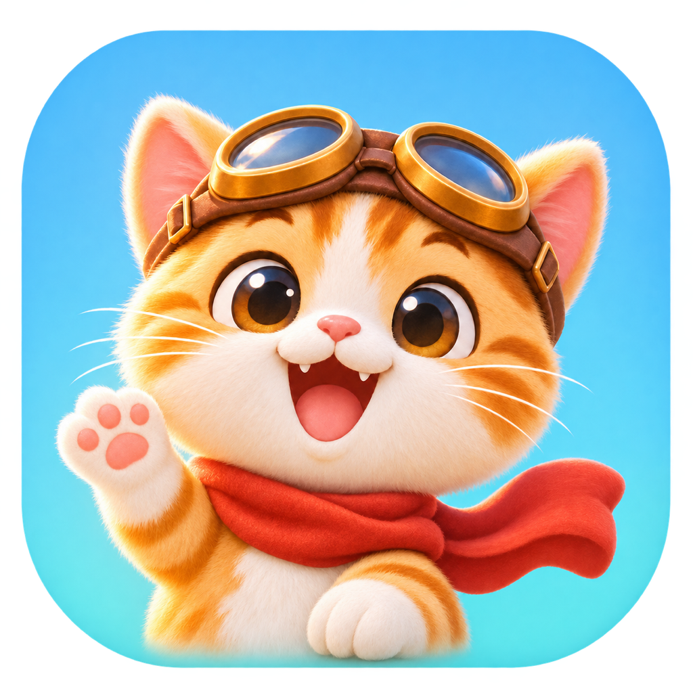
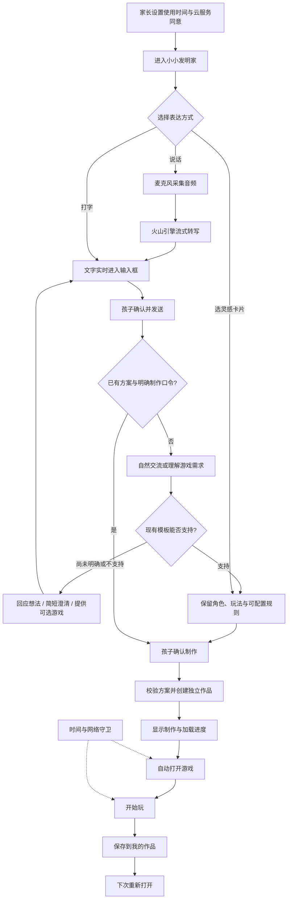
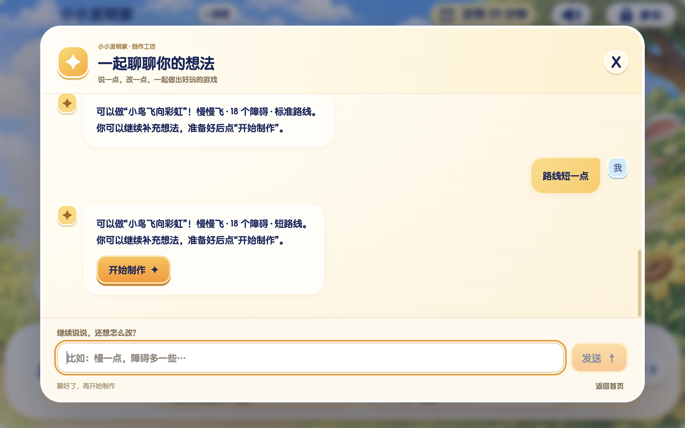
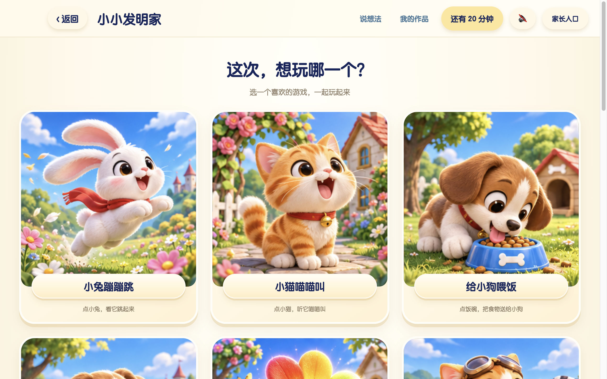
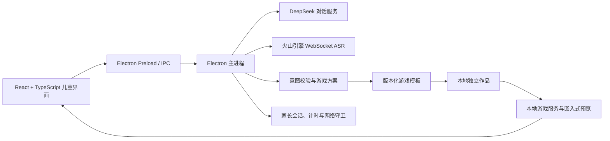

  

<h1 align="center">小小发明家 · Little Inventor</h1>

<strong>说一个想法，聊一聊，把自己的小游戏玩起来。</strong>

面向 4–6 岁儿童的 AI 游戏创作桌面应用 · 自然对话 · 语音输入 · 模板创作 · 本地作品

> **这是项目展示仓库，包含产品介绍、流程图与界面截图，暂不包含应用源码或安装包。** 本地版本处于内部体验阶段，尚未完成真实家庭与儿童验收。源码公开需先明确上游分发授权。

## 让孩子从“我想玩”走向“我想做”

小小发明家从孩子熟悉的聊天开始。孩子可以说“我喜欢小猫”，先和 AI 聊聊小猫，再慢慢想到“小猫开赛车”。选好游戏后，说“给我制作吧”，应用就会进入制作进度，准备好后打开游戏。

当前创作方式是**优先复用已有游戏模板，按支持的角色和规则生成独立作品**。普通闲聊不会直接触发制作；超出模板能力的要求需要解释、澄清或另选方案。应用不会因为模型回复“准备好了”，就把尚未创建的游戏当作已经完成。

## 已实现的体验

| 能力 | 当前行为 |
| --- | --- |
| 自然对话 | 接入 DeepSeek，回应招呼、兴趣和追问，逐步引导到现有游戏 |
| 语音输入 | 火山引擎双向流式 ASR，将说话内容逐步转成输入框中的文字，可编辑后发送 |
| 直接开始制作 | 已确认游戏后，识别“开始制作”“给我制作吧”等口令，执行实际创建 |
| 图文灵感库 | 通过插画卡片选择赛车、飞行、坦克、机器人设施与点击互动 |
| 制作到游玩 | 创建独立作品、显示准备进度，随后自动进入游戏页面 |
| 本地作品 | 保存作品，并从“我的作品”重新打开 |
| 家长控制 | 使用时间、云服务同意与联网状态检查；断网时暂停游戏 |

语音转文字使用流式传输；当前 DeepSeek 对话回复使用非流式请求。家长授权和服务配置是使用云端对话、语音功能的前提。

## 工作流程

制作是应用执行的明确动作。对话用于理解与引导，经过校验的游戏方案才会交给创建服务；游戏模板原件与孩子保存的作品分开维护。

## 界面展示

以下是本机开发验证时保存的真实应用截图，不是儿童试用记录。截图可能包含早期布局与文案；游戏内画面也不等同于灵感卡片插画。

### 一起聊聊想法

孩子可以继续调整支持的规则，也可以确认后开始制作。

### 从图片找灵感

小兔蹦蹦跳、小猫喵喵叫、给小狗喂饭……用熟悉的角色帮助孩子选择。

## 当前游戏范围

| 游戏类型 | 已接入的内容 | 边界 |
| --- | --- | --- |
| 彩虹赛车 | 小猫、小兔、恐龙；换道、星星、路锥与终点 | 不等于自由驾驶或联机竞速 |
| 飞行 | 小鸟、飞机；到达终点 | 小鸟支持慢速/正常速度、障碍数量和路线长度配置 |
| 玩具坦克 | 小猫、小兔、恐龙；玩具靶互动 | 没有敌方反击 |
| 机器人设施 | 简化操作的设施探索与机器人对抗 | 独立于坦克玩法 |
| 点击互动 | 小兔跳跃、小猫叫、给小狗喂食、玩球、花朵变色 | 只支持已经实现的动作 |

模板目前均为内部候选，`childReady: false`。图标、封面或一次开发验证不能代替儿童适龄与家庭体验验收。

## 技术结构

- **界面与桌面宿主：** React 19、TypeScript、Vite、Electron。
- **游戏：** 根据模板使用 Canvas 2D 或 Three.js；复用已实现的玩法。
- **对话：** 当前代码配置模型标识为 `deepseek-flash`；调用方需自行确认账户可用性。
- **语音：** 火山引擎双向流式语音识别，音频在主进程侧对接服务。
- **存储：** 作品保存在本机；对话与语音启用后需要向对应云服务发送文本或音频。

## 获取与参与

当前仓库用于展示产品方向和已实现的本机体验，不提供可克隆运行的应用源码，也没有公开安装包。

欢迎通过 [Issues](https://github.com/xma28016-gif/little-inventor/issues) 分享体验建议、模板想法或交流上游授权。请不要上传儿童个人信息、录音、账号凭据或 API Key。

## 接下来

- 完成上游代码和复用素材的分发授权核对，再确定完整源码的开源许可证。
- 开展真实家庭与儿童体验，验证理解、操作、反馈与退出路径。
- 改善麦克风权限、网络异常和模型服务不可用时的体验。
- 在能力清晰、可验证的前提下扩展模板与可配置规则。

## 来源与许可证状态

本地实现基于 [Innate-Labs/Noobi.ai](https://github.com/Innate-Labs/Noobi.ai)，部分游戏参考或改造自 [Xtbreak/heybox-universe](https://github.com/Xtbreak/heybox-universe)。感谢上游作者。

截至 2026-11-12，上述两个仓库未检测到开源许可证；Noobi.ai 的 README 也明确说明尚未发布许可证。因此，本项目暂不对这些第三方代码声明 MIT、Apache-2.0 或其他重新授权，也不把公开项目介绍等同于完整软件已经开源。源码公开分发需先取得相应授权或替换相关实现。参见 [GitHub 的仓库许可说明](https://docs.github.com/en/repositories/managing-your-repositorys-settings-and-features/customizing-your-repository/licensing-a-repository)。

展示图片仅用于介绍本项目，不代表对第三方代码、素材或商标的统一授权。
